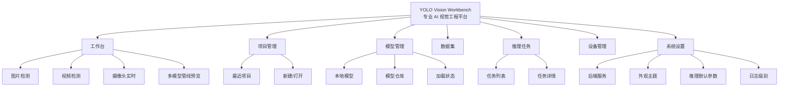
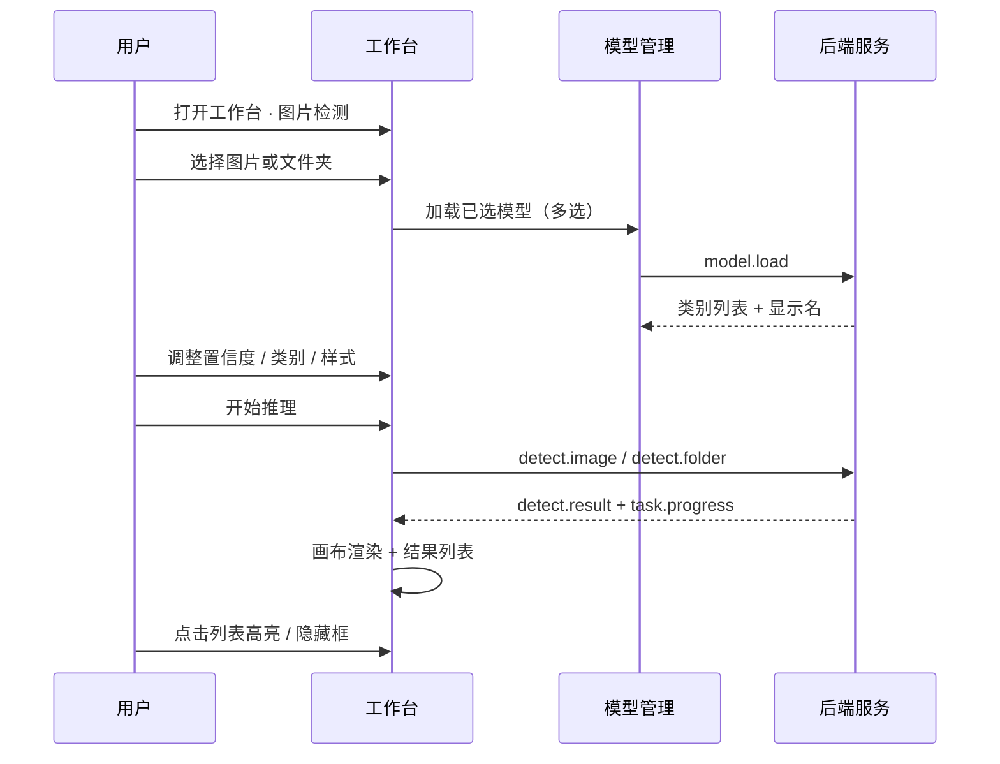

# YOLO Vision Workbench · 页面信息架构（IA）

> 版本：v0.1 · 2026-10
> 配套：`UI_DESIGN_SPEC.md`、`LOCALIZATION.md`
> 用途：P1-M02 起页面开发的唯一导航与布局依据

---

## 1. 产品信息架构总览



---

## 2. 全局壳层（五区）

```svg
<svg xmlns="http://www.w3.org/2000/svg" viewBox="0 0 680 420" font-family="PingFang SC, Microsoft YaHei, sans-serif">
  <!-- top bar -->
  <rect x="20" y="24" width="640" height="40" rx="8" fill="#FFFFFF" stroke="#D5DCE6"/>
  <text x="40" y="49" font-size="13" font-weight="600" fill="#1C2430">YOLO Vision Workbench</text>
  <text x="150" y="49" font-size="11" fill="#5B6B7C">项目：工地安全检测</text>
  <rect x="430" y="34" width="72" height="20" rx="4" fill="#E5F7EE"/>
  <text x="446" y="48" font-size="11" fill="#1F9D66">后端就绪</text>
  <text x="530" y="49" font-size="11" fill="#5B6B7C">浅色</text>

  <!-- left nav -->
  <rect x="20" y="76" width="88" height="280" rx="8" fill="#FFFFFF" stroke="#D5DCE6"/>
  <text x="36" y="102" font-size="11" font-weight="600" fill="#2F6FED">工作台</text>
  <text x="36" y="132" font-size="11" fill="#5B6B7C">项目管理</text>
  <text x="36" y="162" font-size="11" fill="#5B6B7C">模型管理</text>
  <text x="36" y="192" font-size="11" fill="#5B6B7C">数据集</text>
  <text x="36" y="222" font-size="11" fill="#5B6B7C">推理任务</text>
  <text x="36" y="252" font-size="11" fill="#5B6B7C">设备管理</text>
  <text x="36" y="282" font-size="11" fill="#5B6B7C">系统设置</text>
  <rect x="20" y="88" width="3" height="18" fill="#2F6FED"/>

  <!-- center workspace -->
  <rect x="120" y="76" width="360" height="280" rx="8" fill="#EEF1F6" stroke="#D5DCE6"/>
  <text x="300" y="130" text-anchor="middle" font-size="14" font-weight="600" fill="#1C2430">中间工作区</text>
  <text x="300" y="152" text-anchor="middle" font-size="11" fill="#5B6B7C">图片检测 / 视频 / 列表 / 画布</text>
  <rect x="160" y="180" width="280" height="140" rx="6" fill="#E8ECF2" stroke="#B7C2D2"/>
  <text x="300" y="255" text-anchor="middle" font-size="12" fill="#8A96A6">检测画布（图像为主角）</text>

  <!-- right panel -->
  <rect x="492" y="76" width="168" height="280" rx="8" fill="#FFFFFF" stroke="#D5DCE6"/>
  <text x="576" y="102" text-anchor="middle" font-size="11" font-weight="600" fill="#1C2430">右侧属性 / 参数</text>
  <text x="508" y="132" font-size="10" fill="#5B6B7C">模型</text>
  <text x="508" y="156" font-size="10" fill="#5B6B7C">置信度 0.45</text>
  <text x="508" y="180" font-size="10" fill="#5B6B7C">显示样式</text>
  <text x="508" y="204" font-size="10" fill="#5B6B7C">选中对象属性</text>
  <text x="508" y="228" font-size="10" fill="#5B6B7C">系统状态</text>

  <!-- bottom console -->
  <rect x="20" y="368" width="640" height="32" rx="8" fill="#FFFFFF" stroke="#D5DCE6"/>
  <text x="40" y="388" font-size="11" fill="#5B6B7C">控制台：日志 | 任务 | 设备（可折叠）</text>
</svg>
```

| 区 | 中文名 | 职责 |
|----|--------|------|
| 顶栏 | — | 产品名、当前项目、后端状态、主题、设置入口 |
| 左导航 | 模块切换 | 七个一级模块 |
| 中间 | 工作区 | 当前模块主内容 |
| 右栏 | 属性 / 参数 | 上下文相关，可折叠 |
| 底部 | 控制台 | 日志、任务进度、设备输出 |

---

## 3. 一级模块定义

### 3.1 工作台 `/workbench`

**定位**：日常推理作业入口（最常用）。

| 区 | 内容 |
|----|------|
| 左（可选） | 任务类型切换：图片检测 / 视频检测 / 摄像头 |
| 中 | 画布 + 媒体列表（缩略图） |
| 右 | 模型多选、配置方案、置信度、跳帧、框持续、标签模板、样式 |
| 右下 | 识别结果列表（可高亮、隐藏） |
| 底 | 进度与日志 |

**子视图**

| 视图 | 输入 | 主操作 | 输出 |
|------|------|--------|------|
| 图片检测 | 单图 / 文件夹 | 开始推理 | 画布叠加 + 结果列表 |
| 视频检测 | 视频文件 | 开始 / 暂停 / 导出 | 时间轴 + 帧结果 |
| 摄像头实时 | USB / RTSP | 打开摄像头 / 录制 | 实时预览 |

### 3.2 项目管理 `/projects`

| 区 | 内容 |
|----|------|
| 中 | 最近项目列表（名称、路径、最后打开、缩略） |
| 主操作 | 新建项目、打开项目、重命名、删除（慎） |
| 右 | 项目详情：模型绑定、配置方案、历史任务摘要 |

### 3.3 模型管理 `/models`

| 区 | 内容 |
|----|------|
| 中 | 本地模型表：ID、名称、后端（YOLO/ONNX…）、任务类型、路径、状态 |
| 右 | 选中模型详情：类别列表（原名 / 显示名）、默认参数、渲染色 |
| 次级 | 模型仓库 Tab（只读官方包；后续下载） |

### 3.4 数据集 `/datasets`

| 区 | 内容 |
|----|------|
| 中 | 图片/视频集合、划分（训练/验证预留） |
| 说明 | P1 可只做「项目内媒体库」轻量版，避免做成训练平台 |

### 3.5 推理任务 `/tasks`

| 区 | 内容 |
|----|------|
| 中 | 任务表：ID、类型、状态（中文）、进度、开始时间、耗时 |
| 详情 | 参数快照、关联配置方案、日志、结果跳转到工作台 |
| 操作 | 暂停 / 继续 / 取消 / 重跑 / 导出 |

### 3.6 设备管理 `/devices`

| 区 | 内容 |
|----|------|
| 中 | CPU / CUDA / NPU 列表、可用性、显存/内存 |
| 右 | 后端服务信息：版本、PID、端口、运行时长、重启次数 |

### 3.7 系统设置 `/settings`

| 分区 | 项 |
|------|-----|
| 后端服务 | 端口、Python 路径、自动启动、日志级别 |
| 外观 | 主题（浅色/暗色）、字号、语言（默认中文） |
| 推理默认 | 默认配置方案、设备、跳帧、框持续 |
| 路径 | 项目目录、模型目录、导出目录 |
| 关于 | 版本、许可证、开源地址 |

---

## 4. 关键任务流（信息流）

### 4.1 图片推理主路径



### 4.2 启动与状态

```
启动应用
  → 后端服务启动中（顶栏状态）
  → 就绪 → 工作台可用
  → 失败 → 状态栏「失败」+「重启后端服务」+ 日志
```

---

## 5. 路由表

| 路径 | 标题（中文） | 权限/状态 |
|------|--------------|-----------|
| `/workbench` | 工作台 | 需后端就绪（否则空状态引导） |
| `/projects` | 项目管理 | 可用 |
| `/models` | 模型管理 | 可用 |
| `/datasets` | 数据集 | P1 简版 |
| `/tasks` | 推理任务 | 可用 |
| `/devices` | 设备管理 | 可用 |
| `/settings` | 系统设置 | 可用 |
| `/` | → 重定向 `/workbench` | |

默认落地页：**工作台**（不是英文 Dashboard）。

---

## 6. 空状态与引导文案（中文）

| 页面 | 条件 | 文案 | 主按钮 |
|------|------|------|--------|
| 工作台 | 无媒体 | 「选择图片或文件夹开始检测」 | 选择图片 |
| 工作台 | 无模型 | 「请先加载检测模型」 | 前往模型管理 |
| 项目 | 无项目 | 「打开或新建项目以开始」 | 新建项目 |
| 任务 | 无任务 | 「暂无推理任务」 | — |
| 结果 | 无结果 | 「点击「开始推理」查看检测框」 | 开始推理 |
| 日志 | 无日志 | 「日志将显示在这里」 | — |

---

## 7. 状态词与颜色映射

| 内部 status | 界面中文 | 色 |
|-------------|----------|----|
| ready | 就绪 | 绿 |
| starting / connecting | 启动中 / 连接中 | 蓝 |
| restarting | 重启中 | 琥珀 |
| unhealthy | 状态异常 | 琥珀 |
| failed | 失败 | 红 |
| pending | 等待中 | 灰 |
| running | 进行中 | 蓝 |
| paused | 已暂停 | 琥珀 |
| completed | 已完成 | 绿 |
| cancelled | 已取消 | 灰 |

---

## 8. 与 M01 差异（实现提醒）

| M01 | 目标 IA |
|-----|---------|
| 单页 + Health/Logs 英文 | 七模块工作台 + 全中文 |
| 顶栏为主操作 | 顶栏仅状态；主导航在左 |
| 无右栏 | 属性/参数右栏 |
| 无空状态 | 全空状态文案 |

**P1-M02 建议实施顺序**：`locales` 字典 → 壳层五区 + 左导航 → 模型管理页 → 工作台（图片检测）→ 其后页面渐进。

---

## 9. 开放项（可后定）

1. 「数据集」P1 是否仅展示项目媒体库（默认：是）
2. 是否保留英文 locale 文件（默认：暂缓）
3. 顶栏是否显示「最近项目」下拉（默认：显示当前项目名 + 切换入口）
